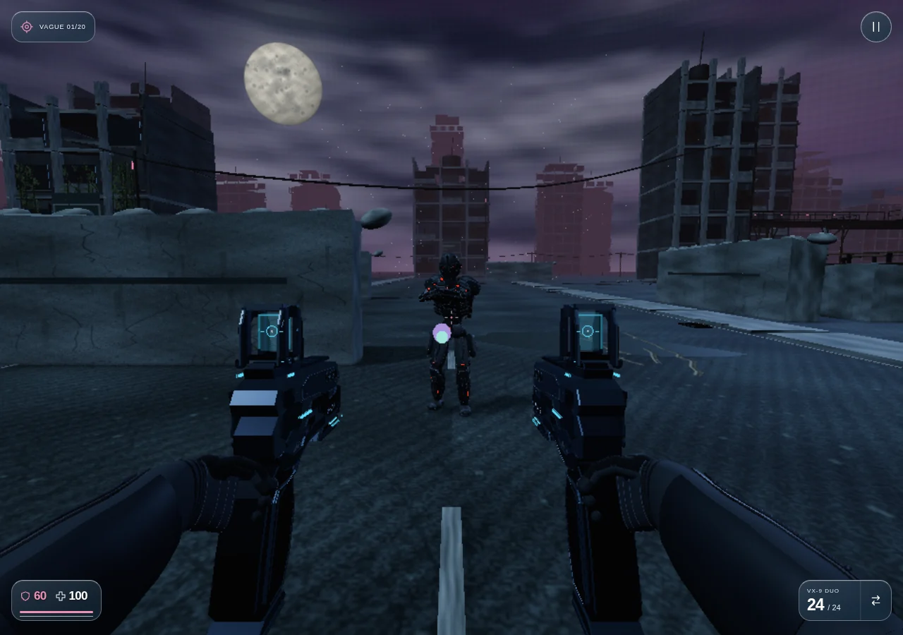
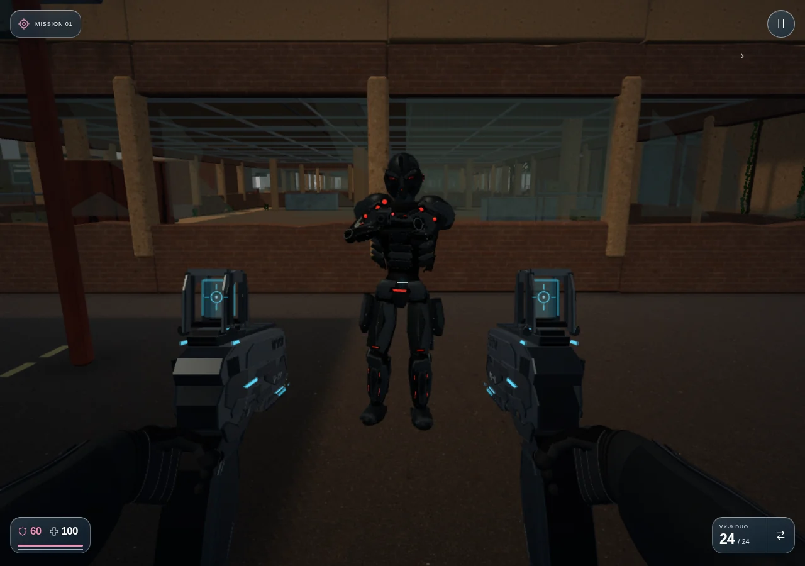

# Version 3.65 — RECO1 en jeu

RECO1 remplace la **Sentinelle légère** (forme interne `seer`) en campagne et dans l’Arène. Les compositions de rencontres et le nombre d’ennemis restent ceux du jeu ; il apparaît dès la première vague de Survie et dans les postes de mission qui utilisaient cette unité.

## Blindage et combat

- 750 PV de base à la vague 1, avec la progression de résistance et les variantes élites existantes.
- Les tirs directs sur le blindage infligent 50 % de leur puissance. Les optiques ont une protection de 20 %, puis le multiplicateur de tête habituel s’applique : au premier palier, un VX-9 fait 12 au torse et 48 à la tête.
- La mêlée, les explosions, les charges, les éliminations, le score et les changements de vague utilisent les règles communes. RECO1 reste destructible.
- Les zones de touche, la hauteur de perception et la recherche de couvert suivent le nouveau gabarit de 1,82 m ; aucun ancien volume de tête à presque 2 m ne subsiste pour cette unité.
- La position et l’orientation de la bouche du canon sont communes à l’IA, à l’émission des projectiles et au modèle. La visée corrige l’angle horizontal et vertical depuis la vraie bouche, y compris en hauteur, accroupi et à échelle de pièce réduite. Les tirs restent physiques, sans guidage après leur départ et bloqués par le décor.

## Modèle et animation

Le modèle V10 approuvé est conservé : casque fermé, optiques en verre, blindage graphite, abdomen segmenté, mécanique apparente, mains et carabine. Les 41 os et les vrais clips du pompier RLH sont repris. Les appuis restent au sol, la course garde sa phase de suspension et les deux mains suivent leurs prises.

Le rendu utilise 17 lots GPU et 59 742 triangles avec géométrie partagée entre instances, sans lumière dynamique supplémentaire. Les autres robots gardent leur budget. Le modèle n’est construit ni téléchargé pièce par pièce pendant les vagues ; ses données locales sont décodées une fois. Les détails de provenance et de reconstruction sont dans [assets/reco1](../../assets/reco1/README.md).

## Vérification

`npm test` : **552 tests réussis, aucun échec**, dont 11 contrôles dédiés à RECO1. Syntaxe des modules et outils vérifiée ; `git diff --check` sans erreur.

Les tests dédiés vérifient le remplacement en Arène et M01, les buffers partagés et les poses indépendantes, les mouvements natifs, les appuis figés en pause, la concordance exacte canon/projectile, les tirs hostiles réels vers le joueur, le blocage par les murs, les dégâts réduits et l’élimination avec les vrais projectiles VX-9. Les anciens tests de zones et de résistance utilisent les dimensions et les PV de la nouvelle unité.

Les captures sont issues de parties dans Chromium avec rendu logiciel et positions préparées sur un sol libre. Aucun résultat de performance sur Quest ou iPhone physique n’est annoncé.

Le parcours navigateur lance réellement l’Arène depuis le menu, observe RECO1 et un projectile hostile, puis tire par la touche Espace : le VX-9 consomme une munition et retire 12 PV au blindage. Le second parcours charge M01 et vérifie le remplacement au poste initial `(-22, 77)`, parmi les huit patrouilleurs. Les deux chargements n’ont produit ni erreur JavaScript ni ressource locale manquante. [Rapport](RECO1_BROWSER_VERIFICATION.json).

