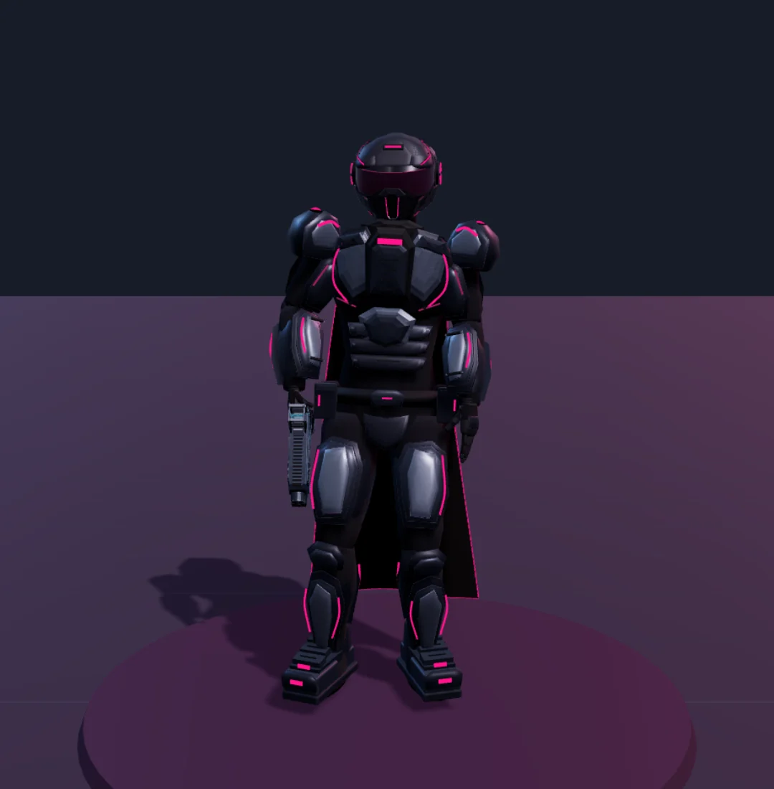
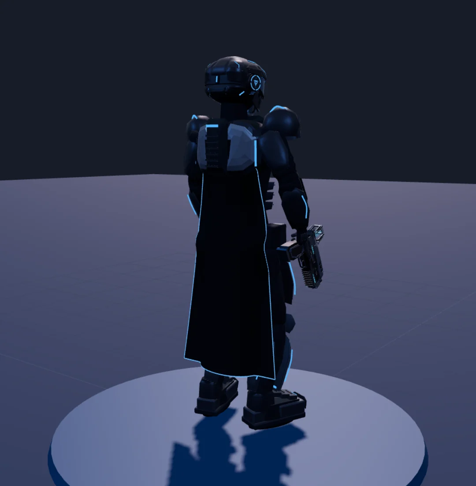
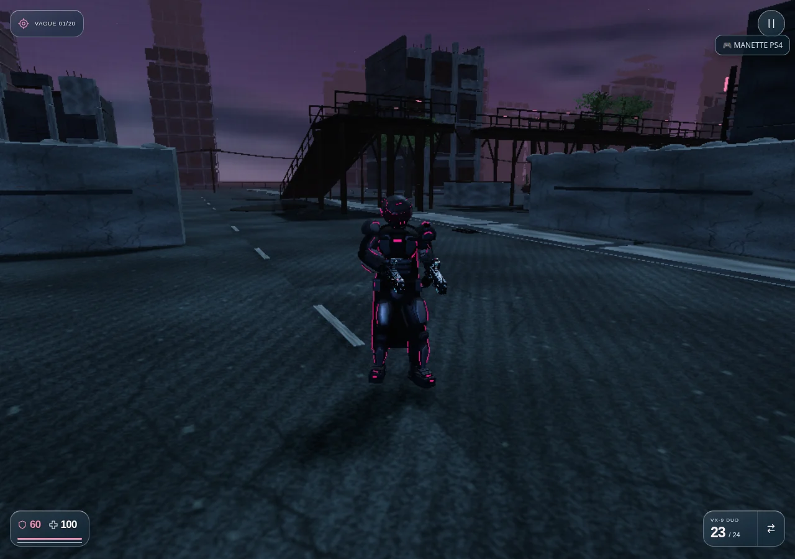

# Version 3.66 — GHJU et LYLU, Shadow VII

Les personnages 3D se rapprochent des quatre fonds d’accueil et de chargement de Vesper, conservés sans modification : armure graphite et acier, casque fermé à visière panoramique, module d’oreille circulaire, lumière rose pour GHJU et bleue pour LYLU, cape noire tissée.

## Formes et matières

Les épaules et avant-bras sont affinés, avec des surfaces courbes et des biseaux qui remplacent les grands aplats triangulés. Le thorax est plus étroit pour GHJU. Un abdomen segmenté, une ceinture ajustée, un bouclier de bassin et des protections de hanche relient le haut du corps aux jambes ; ils suivent leurs articulations respectives. La visière garde une teinte sombre et une surface réfléchissante. La cape s’évase vers l’ourlet, descend plus bas et reste au-dessus du sol quand le personnage s’accroupit.

Le squelette RLH de 34 os et ses cinq clips sont conservés. Les plaques sont rendues en **19 lots de peau**, environ 45 000 triangles, qui partagent les os du personnage. Elles conservent leurs géométries d’édition pour les mesures et contrôles. Dans une même vue d’atelier, avec le même éclairage et le même pistolet, le compteur passe de **121 à 58 appels de rendu**, pour 128 604 puis 131 126 triangles dans la scène. Ce comptage n’est pas une mesure de fréquence d’images sur un appareil physique.

## Mouvement

- Cadence liée à la vitesse réelle, en ignorant la translation verticale d’un ascenseur. Une commande bloquée par un mur ne maintient plus un cycle de marche.
- Transitions des clips avec phase de locomotion conservée. Le déplacement rapide utilise la course ; le recul inverse la lecture du cycle et reste une marche contrôlée.
- Les pas latéraux orientent le bassin et les jambes, avec compensation du buste pour garder l’arme face à la cible.
- Les pieds en phase d’appui conservent leur contact dans le monde, sans étirer les os. Les appuis se libèrent pendant la phase de suspension et le saut.
- Suspension verticale du clip de course conservée, genoux plus fléchis au sommet du saut, légère compression à la réception et retour amorti à la pose normale.
- Cape sensible au déplacement, aux changements de direction et au mouvement des jambes. Aucun cumul de pose ou de simulation du tissu à temps figé.

La physique de déplacement, les vitesses du joueur, les statistiques, les armes et les commandes restent celles du jeu. Les mains sont toujours résolues sur les prises des neuf armes. Le modèle commun est utilisé par l’Arène, le stand, M02, les compagnons et l’atelier ; la vue subjective et les mains suivies au casque conservent leur fonctionnement.

## Vérification et aperçu

`npm test` : **578/578 tests réussis**, dont dix nouveaux cas sur les deux personnages. Ils contrôlent les sommets de peau contre les vraies attaches d’os en mouvement, les lots et leur libération, la cadence et les transitions, le recul et le pas latéral, les neuf prises d’armes, les contacts au sol, le saut, la réception, la pause et le tissu.

Le navigateur lance réellement chaque personnage depuis le menu, passe en troisième personne avec V, avance avec W puis tire avec Espace. Les deux personnages courent à leur vitesse réelle et consomment une munition au tir, sans erreur JavaScript ni ressource locale manquante. L’atelier autonome est testé hors connexion en viewport 390 × 844, avec sélection de GHJU/LYLU et du recul. [Rapport navigateur](HEROES_BROWSER_VERIFICATION.json).

Les captures proviennent de Chromium/SwiftShader, avec framebuffer réduit et caméra préparée. Aucun essai sur Quest, Safari ou iPhone physique, ni promesse de fréquence d’images. Les fonds illustrés restent des illustrations, pas des captures du moteur 3D.

[Voir GHJU](https://pink-war.vercel.app/personnage.html?character=ghju&v=3.66.0) · [Voir LYLU](https://pink-war.vercel.app/personnage.html?character=lylu&v=3.66.0)

