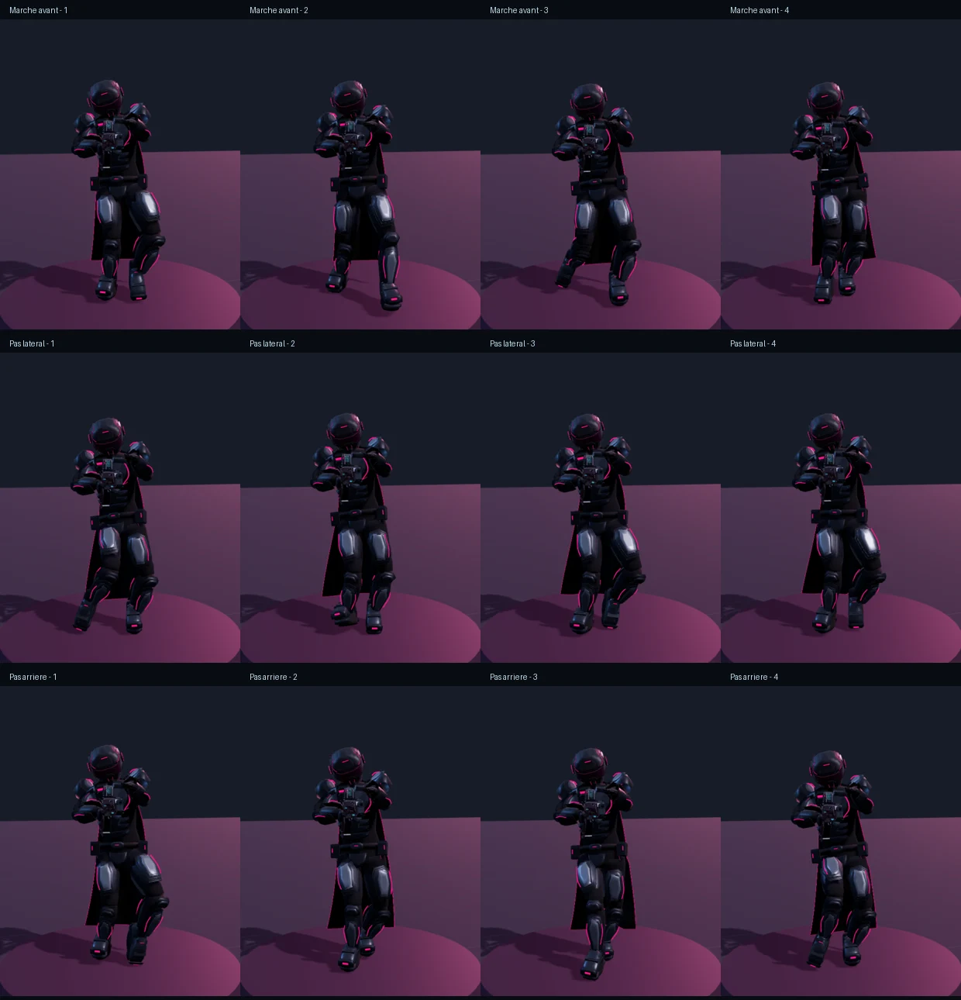
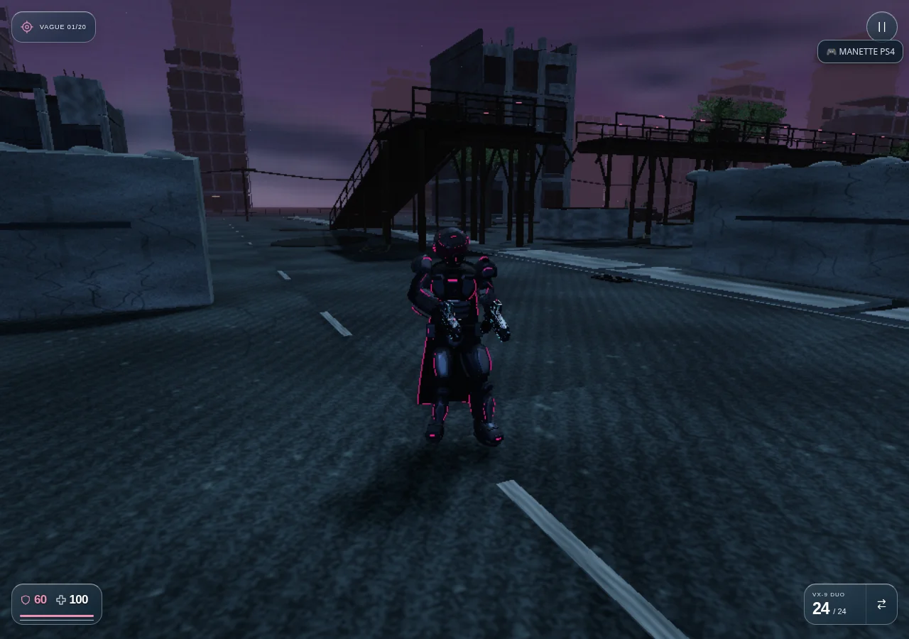
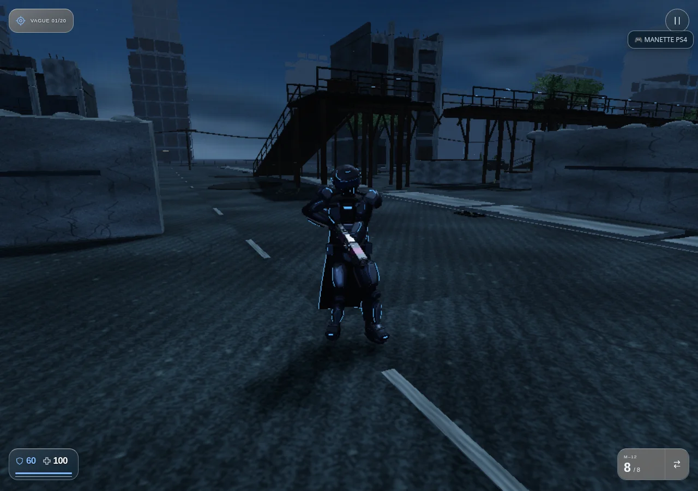

# Version 3.66.1 — appuis et articulations de GHJU / LYLU

Les pas latéraux gardent les jambes séparées et limitent la rotation du bassin à environ 8°. Les pas arrière utilisent une trajectoire dirigée vers l’arrière avec une flexion anatomique des genoux. Le cycle RLH avance dans le temps dans les quatre directions.

La marche avant présentait une rupture lorsque le pied quittait son appui : la cheville pouvait revenir brutalement de près de 18 cm dans le repère local du modèle vers sa pose animée. La correction d’appui se libère désormais progressivement, avec un amortissement du bassin. Les transitions marche/course s’alignent sur le contact de talon mesuré dans les clips natifs et utilisent deux seuils de vitesse pour éviter les bascules répétées.

L’atelier et le jeu partagent maintenant le même calcul : l’atelier intègre un déplacement virtuel pour reproduire les appuis d’un personnage réellement déplacé. Les sauts, les ascenseurs et les personnages à des positions éloignées de l’origine gardent leur repère propre.

Sur le même parcours de mesure à 60 Hz, le déplacement maximal de cheville entre deux images passe de 17,93 à 4,25 cm en marche avant, et de 17,75 à 3,13 cm en recul, dans le repère local du rig. Les pieds ne se croisent plus dans les quatre séquences mesurées.

## Formes

Semelles effilées avec voûte et talon, dessus de chaussure continu, brides ajustées au cou-de-pied et surfaces centrales de plaques plus planes, entourées de biseaux. Le contact au sol utilise tous les points de la vraie botte : une protection d’orteil peut devenir le point le plus bas pendant la rotation du pied.

Les deux personnages conservent leurs 34 os RLH, les prises des neuf armes et les 19 lots de rendu de l’armure. Les illustrations de référence restent inchangées. Les ajouts de galerie présents sur la branche principale sont conservés.

## Vérification

`npm test` : **587/587 réussis** ; les trois tests de la galerie intégrés ensuite réussissent aussi, soit 590 cas distincts sans échec.

Les neuf nouveaux tests couvrent les deux personnages à des pas de simulation de 30, 60 et 120 Hz, dans les quatre directions, avec contrôle de l’écartement des pieds, de la flexion des genoux et des variations de position et de vitesse des chevilles. Ils comparent aussi l’atelier stationnaire au déplacement réel sur un étage à 4,8 m, et vérifient le dégagement des bottes au sol en position debout et accroupie.

Les essais du navigateur utilisent le menu et les touches W, D, S, A, V et Espace du jeu : déplacement dans les quatre directions, troisième personne et consommation de munitions au tir pour GHJU et LYLU. L’atelier autonome est également chargé hors connexion en 390 × 844. [Rapport navigateur](HEROES_STRIDE_BROWSER_VERIFICATION.json) · [Mesures de mouvement](HEROES_STRIDE_METRICS.json).

Les captures proviennent du moteur réel sous Chromium/SwiftShader, avec résolution réduite et caméra préparée. Les cadences de simulation testées ne sont pas des mesures de FPS matériel. Aucun essai sur Safari, iPhone ou Quest physique.

[GHJU animé](https://pink-war.vercel.app/personnage.html?character=ghju&v=3.66.1) · [LYLU animé](https://pink-war.vercel.app/personnage.html?character=lylu&v=3.66.1) · [Arène](https://pink-war.vercel.app/?mode=arena&v=3.66.1)

