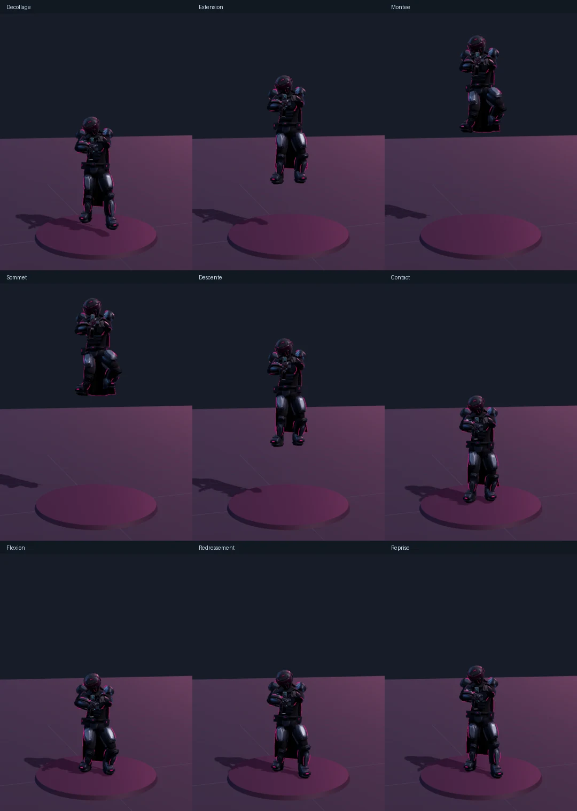
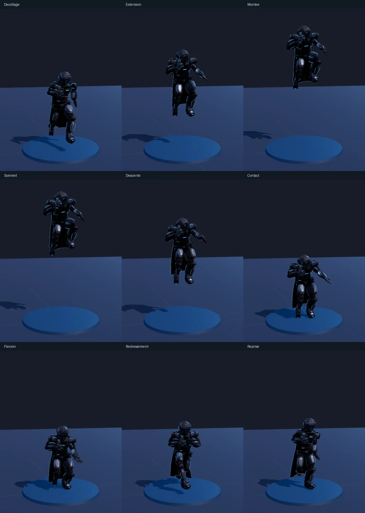
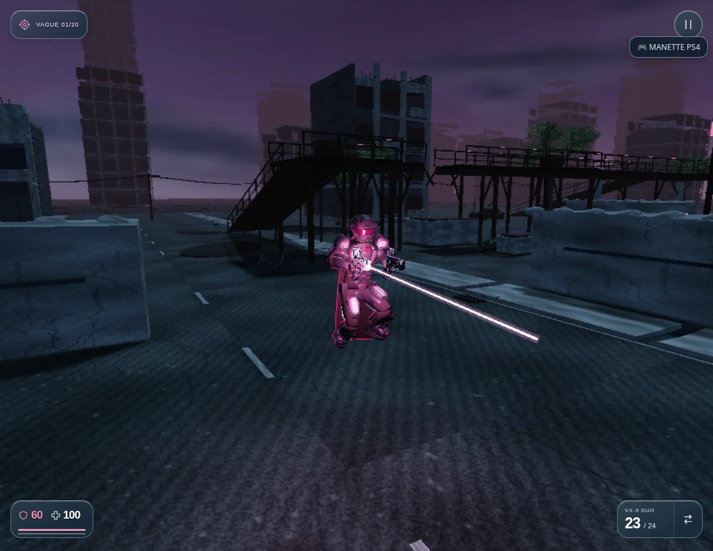

# Version 3.66.2 — saut articulé de GHJU et LYLU

Le saut utilise maintenant une pose de vol progressive sur les 34 os RLH. La marche et la course ne continuent plus à tourner sous le personnage pendant qu’il est en l’air. La trajectoire et les commandes de saut du jeu restent celles de la physique existante.

- **Décollage** : passage depuis la pose réelle des appuis, avec maintien de la correction de hauteur du bassin. Le décalage vertical au changement d’état est supprimé.
- **Montée et sommet** : une jambe mène, l’autre suit ; les genoux se replient à des rythmes différents, les chevilles s’orientent et le buste accompagne le mouvement. La pose continue à évoluer au sommet.
- **Descente** : les jambes se déplient et les pieds se préparent au contact selon la vitesse verticale.
- **Réception** : la flexion du bassin et des genoux se construit après le contact, atteint son maximum environ 85–95 ms plus tard, puis se relâche progressivement. Le buste et le bras libre absorbent aussi le mouvement.
- **Double saut et rebond** : la nouvelle impulsion repart de la pose en vol, sans revenir brutalement à la position debout. Une chute depuis une corniche n’ajoute pas une impulsion de saut visuelle.

Les mêmes prises d’armes restent résolues après la pose du corps. Les bottes utilisent leur volume réel pour rester au-dessus du plan de contact, et les longueurs des os restent intactes. Les 19 lots de rendu de l’armure, les matériaux, les formes et la cape sont conservés.

## Atelier

Le bouton **Saut** garde le déplacement précédent : après **Course**, il montre un saut en course puis reprend la course après la réception. Après **Repos**, il montre un saut sur place. Le même principe couvre les pas latéraux, le recul et les positions de tir. La caméra accompagne une partie de la hauteur du saut pour garder le personnage visible, y compris en portrait. L’ancien aperçu de cape cesse aussi de maintenir le personnage dans son état aérien après son retour au sol.

## Vérification

`npm test` : **599 tests réussis**, aucun échec, test ignoré ou annulé. Les 28 contrôles ciblés du saut et de la locomotion passent également après les derniers ajustements. Syntaxe des modules et du générateur validée.

Neuf nouveaux contrôles utilisent la vraie physique de l’Arène et les vrais modèles : GHJU et LYLU à 30, 60 et 120 Hz, saut sur place puis en course ; séparation des pieds, genoux anatomiques, continuité des articulations, dégagement du volume des bottes, réception retardée et retour au sol. Ils couvrent aussi le double saut, une chute depuis 2,4 m, les prises des neuf armes pendant le saut et le gel exact des os, du tissu et de la phase de vol en pause.

[Rapport navigateur](HEROES_JUMP_BROWSER_VERIFICATION.json) · [Mesures comparatives](HEROES_JUMP_METRICS.json).

Les captures et essais de navigateur proviennent de Chromium/SwiftShader, avec résolution réduite, caméra préparée et vagues ennemies désactivées pour les mesures de mouvement. Les touches J, W, V et Espace commandent la vraie partie ; l’atelier autonome est également vérifié hors connexion en 390 × 844. Les pas de simulation à 30/60/120 Hz ne sont pas des mesures de FPS matériel. Aucun essai sur iPhone, Safari ou Quest physique.

[GHJU — bouton Saut](https://pink-war.vercel.app/personnage.html?character=ghju&v=3.66.2) · [LYLU — bouton Saut](https://pink-war.vercel.app/personnage.html?character=lylu&v=3.66.2) · [Arène](https://pink-war.vercel.app/?mode=arena&v=3.66.2)

