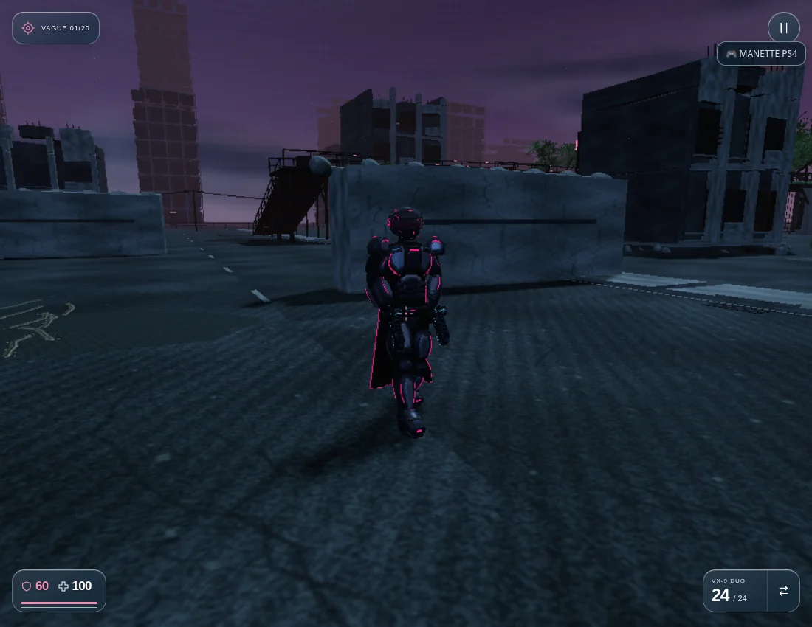
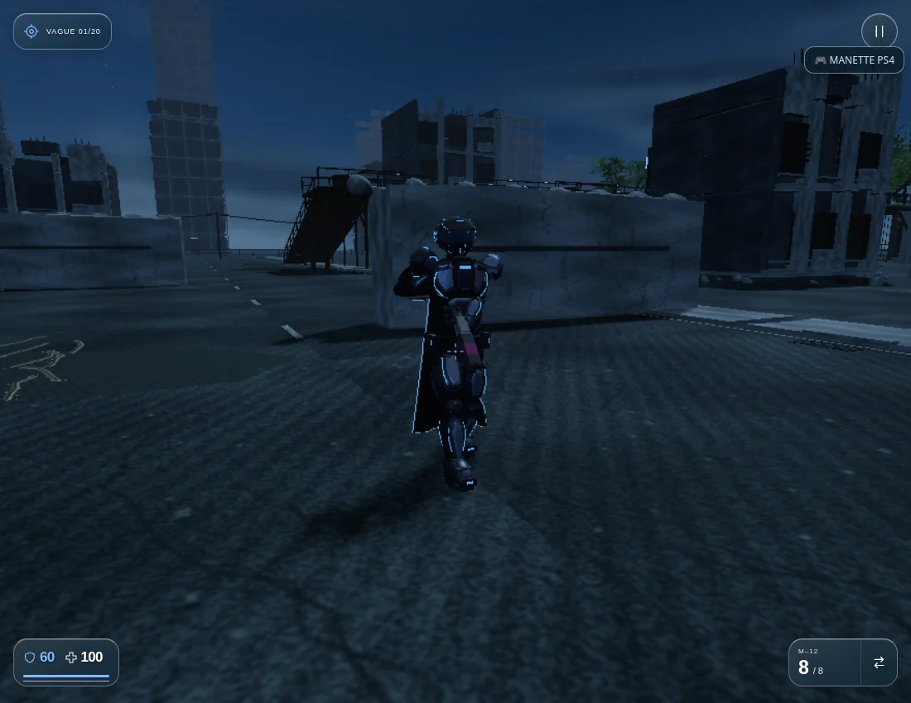
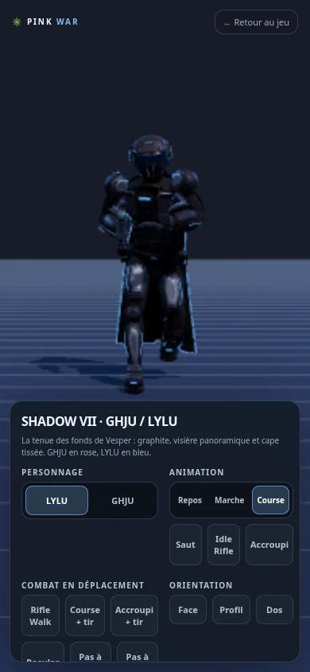

# Version 3.66.3 — appuis de GHJU et LYLU sur le sol réel

Les pas en avant suivent la distance réellement parcourue, la longueur de la foulée et l’échelle du personnage. Pendant l’appui, la botte conserve son point de contact dans le monde ; elle repart vers le prochain appui pendant la phase de balancement. Maintenir une direction contre un mur arrête la cadence.

Les deux pieds interrogent les mêmes surfaces que la physique du joueur : route, trottoirs, bordures, rampes, terrasses et monte-charge. Le pied arrière conserve son altitude sur la rampe lorsque le corps monte ; le monte-charge emporte les deux appuis. Une jambe au-dessus d’un vide ne déclare pas un faux contact avec un sol hors de portée.

La route était affichée 4,5 cm sous le plan physique. Elle est maintenant au même niveau. Les plateaux de terrasse et de monte-charge sont également raccordés à leur hauteur de collision ; peintures et grilles restent à quelques millimètres de leur surface.

Le bassin accompagne les grandes foulées avec une flexion progressive, sans reprendre le décalage vertical du clip de course d’origine. Les jambes gardent leurs longueurs et leur plan de flexion. Le raccord du décollage conserve la pose réellement obtenue au sol ; la réception transmet les pieds au système d’appuis. Tourner sur place déplace un pied à la fois. Les trajectoires latérales et arrière déjà corrigées sont conservées.

## Atelier

Le quadrillage défile à la vitesse du déplacement simulé : le contact est visible dans le même repère que celui du jeu. Le socle s’efface pendant le déplacement. Les aperçus Marche et Course utilisent les vitesses correspondantes du jeu (1,6 et 7 m/s). Le même squelette de 34 os et le même solveur sont utilisés en partie et dans le HTML autonome.

Les 19 lots d’armure, les prises des neuf armes, les formes et les illustrations de référence sont conservés.

## Vérification

`npm test` : **611 tests réussis**, aucun échec, test ignoré ou annulé. Les 30 contrôles ciblés de foulée, saut et contact passent également. Aucun test historique n’a été assoupli pour cette correction.

Les nouveaux contrôles mesurent les sommets réels des bottes à 30, 60 et 120 Hz, en marche, course et sprint. Ils exigent plusieurs images de contact consécutives, moins de 2 mm de dérive horizontale par image pendant l’appui et le contact de la semelle avec le sol. Les cas de rampe, monte-charge, mur, trottoir tourné, pivot et bord de plateforme utilisent la physique du jeu.

Le parcours navigateur utilise le vrai menu et les commandes W, Majuscule, J et V pour les deux personnages. Les positions de rampe, de monte-charge et de mur sont préparées, puis les entrées et la physique normales sont exécutées. L’atelier autonome est vérifié hors connexion en 390 × 844. [Rapport navigateur](HEROES_GROUND_BROWSER_VERIFICATION.json).

Limites des essais : Chromium/SwiftShader, résolution de rendu réduite et vagues désactivées pour les mesures. Les cadences de simulation ne sont pas des mesures de FPS matériel. Aucun essai sur Safari/iPhone ou Quest physique.

[Jouer dans l’Arène](https://pink-war.vercel.app/?mode=arena&v=3.66.3) · [Atelier GHJU](https://pink-war.vercel.app/personnage.html?character=ghju&v=3.66.3) · [Atelier LYLU](https://pink-war.vercel.app/personnage.html?character=lylu&v=3.66.3)

