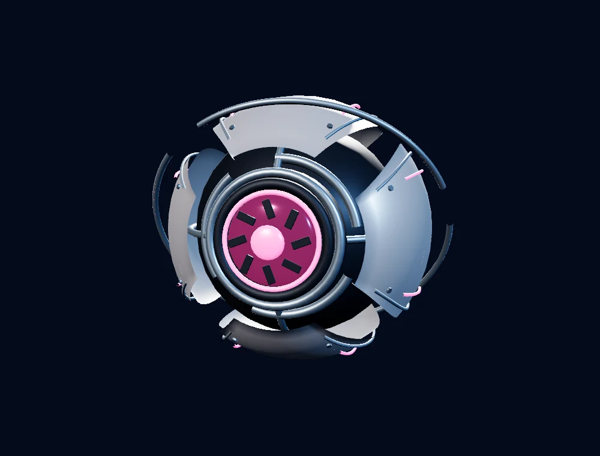
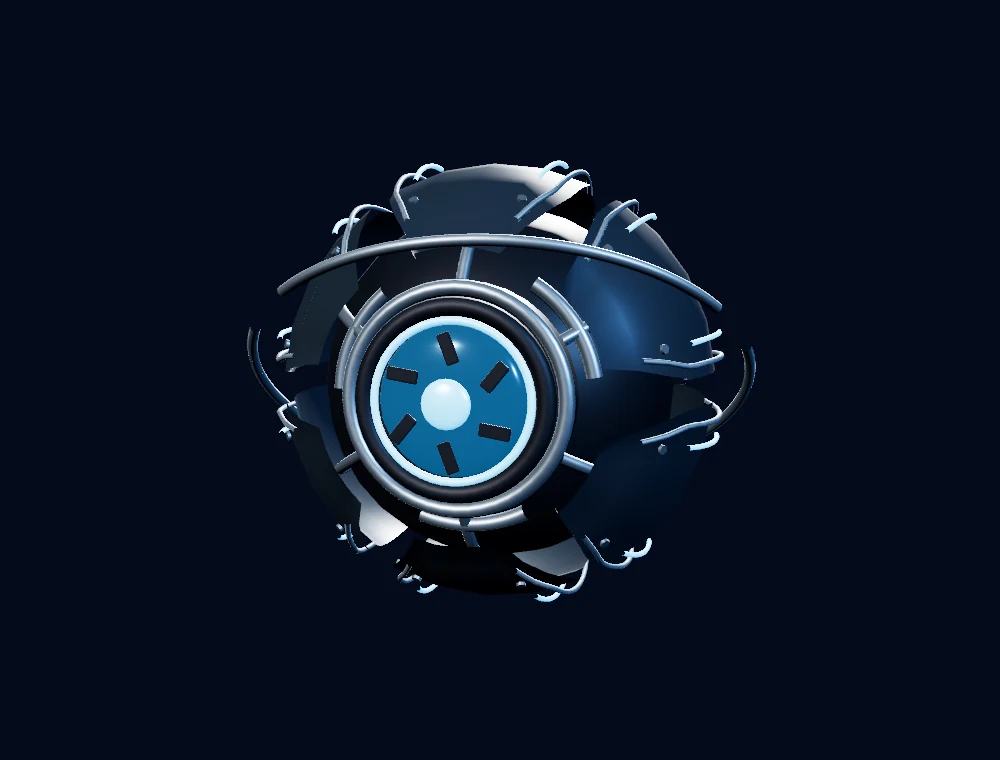
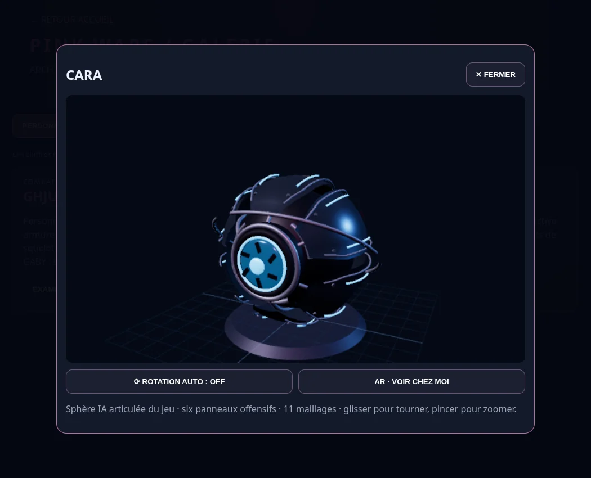

# Version 3.66.4 — nouvelles formes de Gaby et Cara

Les deux sphères ont un véritable châssis interne, des coques épaisses séparées, une optique en retrait, un iris, des fixations et un échangeur thermique arrière. Les ouvertures entre panneaux laissent voir la structure. Le même modèle est utilisé dans le jeu, la galerie et l’atelier des compétences.

| | Gaby · GHJU | Cara · LYLU |
|---|---|---|
| Silhouette | Quatre coques protectrices arrondies | Six panneaux plus angulaires |
| Matériaux | Alliage clair, châssis sombre, phase rose | Graphite bleuté, arêtes métalliques, phase bleue |
| Optique | Iris à huit éléments | Iris à six éléments |
| Animation | Ouverture souple des coques | Ouverture plus prononcée des panneaux |

L’anneau de stabilisation tourne indépendamment. Les panneaux se déplacent autour de leurs charnières, respirent légèrement au repos et s’écartent lors d’une compétence réussie. La face optique reste tournée vers le joueur pendant le suivi, au lieu de tourner continuellement avec tout le corps. Une activation manuelle ramène la sphère devant le joueur ; sa position tient compte de la taille réelle des coques pour éviter leur découpe au bord d’un écran portrait.

Le diamètre est d’environ 35 cm. Chaque modèle utilise **11 lots de rendu**, avec un petit squelette partagé entre ses quatre lots de coques : **4 os pour Gaby, 6 pour Cara**. Gaby compte 24 448 triangles et Cara 25 584. Un seul partenaire est présent auprès du héros. Les détails sont géométriques, sans texture externe ou lumière supplémentaire.

Les compétences, leur coût, leurs dégâts, leurs recharges et le déblocage à **M07** restent ceux de la simulation existante. Les modèles et animations de GHJU et LYLU sont conservés.

## Vérification

La suite complète réussit ses **618 tests**. Après le dernier ajustement de placement portrait, les **22 contrôles ciblés** réussissent également. Les sept nouveaux cas couvrent la silhouette et le coût de rendu des deux modèles, les vrais sommets des coques sous transformation du parent et des charnières, une compétence réelle, la pause exacte, le retour à l’écran et le cadrage portrait, puis la libération unique des géométries, matériaux et palette d’os lors de remplacements répétés.

Le navigateur ouvre directement Gaby et Cara dans la galerie et retrouve les 11 maillages et leur squelette réel. Dans l’atelier en **390 × 844**, la touche G ouvre le menu ; la compétence de phase consomme de l’énergie, crée un projectile réel et déclenche l’ouverture des coques. Aucune erreur JavaScript ou ressource locale manquante. [Rapport navigateur](COMPANIONS_MODELS_BROWSER_VERIFICATION.json).

Les vues de détail ci-dessous sont rendues par le moteur avec la géométrie de production, dans une scène d’inspection éclairée. Les captures de galerie et d’atelier utilisent les vraies interfaces. Essais locaux sous Chromium/SwiftShader avec résolution réduite ; aucun essai sur Safari/iPhone ou Quest physique, ni mesure de FPS matériel. La conversion AR n’a pas été retestée sur appareil.

[Examiner Gaby](https://pink-war.vercel.app/galerie.html?model=GABY&v=3.66.4) · [Examiner Cara](https://pink-war.vercel.app/galerie.html?model=CARA&v=3.66.4) · [Activer les compétences](https://pink-war.vercel.app/compagnons.html?v=3.66.4)

