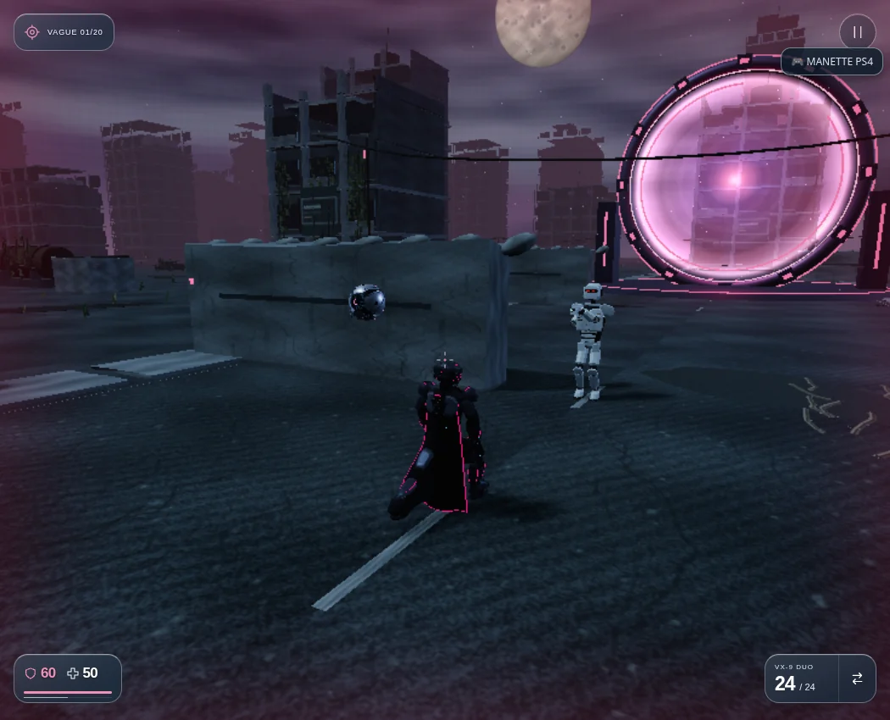
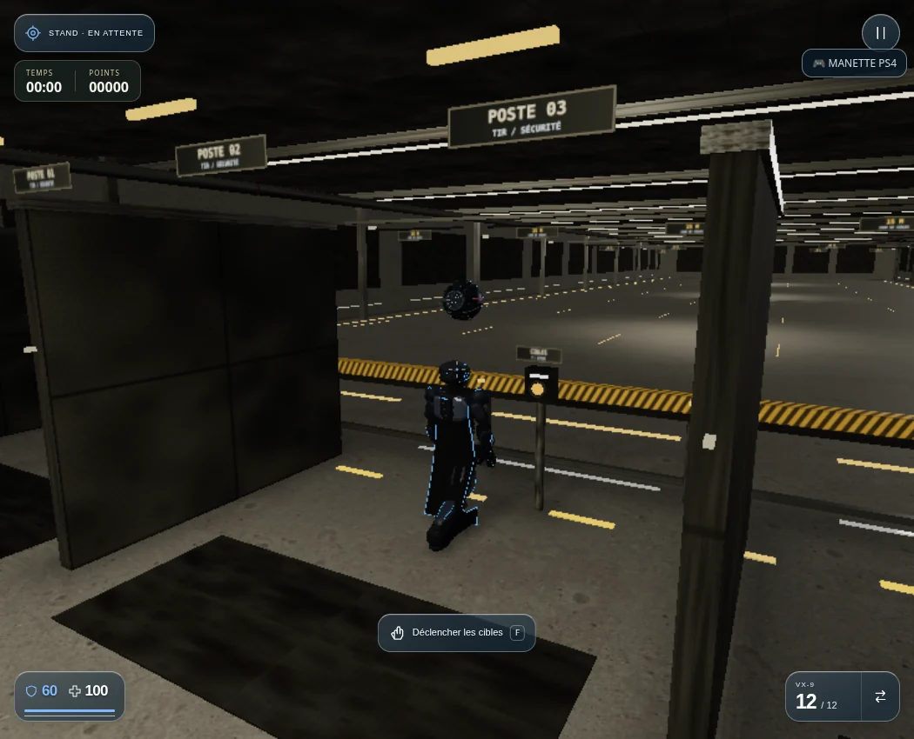
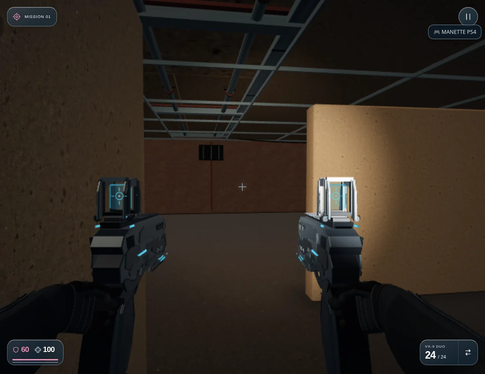

# Version 3.67 — Gaby et Cara en escorte

Gaby accompagne GHJU et Cara accompagne LYLU dès le départ de **M01**, dans **l’Arène** et au **stand de tir**. Le même suivi continue dans M02 et dans la campagne classique. Leur première apparition physique n’est plus réservée à M07 ; les compétences manuelles avancées gardent leur progression à M07.

## Flottaison

La sphère suit le corps du héros à environ 44 cm au-dessus de sa tête, 58 cm en arrière et 40 cm sur le côté. Une petite orbite et une oscillation verticale lente donnent l’effet de flottaison. La position tient compte de l’accroupissement, des étages et des changements de direction. La caméra peut changer entre première et troisième personne sans déplacer le centre de l’orbite. En XR, la position réelle de la tête ajoute le déplacement physique du joueur.

Le trajet et le point d’arrivée sont vérifiés contre les murs et plafonds, avec le rayon de la coque. Quand l’emplacement normal est bloqué, la sphère essaie l’autre côté puis un appui plus proche au-dessus du héros.

## Protection automatique

Le seuil retenu est **la santé du héros strictement inférieure à 50 %**. Une menace doit être engagée, à moins de 22 mètres et visible depuis la sphère. Ni une cible cachée derrière un mur ni une machine simplement en patrouille ne déclenche le tir.

Les projectiles partent du vrai centre optique, voyagent dans la physique commune et peuvent manquer ou rencontrer un obstacle. Les dégâts attendent l’impact. La santé à 50 % ou au-dessus arrête les nouveaux tirs. Le partenaire n’utilise pas les munitions, le recul ou les vibrations de l’arme du joueur.

| Partenaire | Dégâts de base | Intervalle minimal | Coût sur sa réserve |
|---|---:|---:|---:|
| Gaby | 12 | 1,25 s | 12 |
| Cara | 16 | 0,9 s | 14 |

La réserve de chaque sphère est limitée à 100 et se recharge à 4 par seconde. La protection respecte la pause et s’arrête à la mort du héros. Au stand, la sphère accompagne le joueur et ne marque pas de points sur les cibles d’exercice.

## Torche

Un projecteur chaud éclaire réellement les surfaces devant le héros dans l’obscurité. Une sonde échantillonne les lumières visibles de la scène et l’occlusion du ciel et du soleil par les plafonds. Elle ignore la lumière de la compagne pour éviter une boucle d’allumage et d’extinction. L’éclairage s’allume et s’éteint progressivement, avec deux seuils distincts pour éviter le clignotement.

Un seul SpotLight est ajouté, sans carte d’ombres supplémentaire. Sa portée est limitée par le premier obstacle sur l’axe du faisceau. L’éclairage existant du stand est pris en compte et la lampe manuelle de M01 reste utilisable.

## Vérification

`npm test` : **633 tests réussis**, aucun échec, test ignoré ou annulé. Les **34 contrôles ciblés** passent également, dont 15 nouveaux cas consacrés à l’escorte et à l’éclairage.

Les contrôles couvrent les deux profils, la position relative au corps sous changement de caméra, les étages, le seuil exact de santé, la réserve et la cadence, l’origine optique, les vrais impacts, le blocage par un mur posé après le départ du projectile, l’absence de consommation de munitions, la pause, les plafonds, le suivi de tête XR et la torche sous éclairage ambiant, plafond et lampe locale.

Le navigateur démarre les deux héros depuis le vrai menu dans l’Arène et au stand, utilise W et V et vérifie les positions. Un adversaire immobile est préparé dans une vraie ligne de tir libre pour contrôler les seuils à 50 puis 49, les impacts et l’arrêt après récupération. L’éclairage extérieur est atténué puis rétabli pour contrôler la torche. La vraie page de M01 est également lancée pour chaque héros, puis le joueur est placé dans l’atelier couvert du décor de production : la torche y s’allume avec les lumières normales du niveau. [Rapport](COMPANIONS_ESCORT_BROWSER_VERIFICATION.json).

Limites : essais locaux sous Chromium/SwiftShader, résolution réduite, positions et adversaire de préparation, simulation avancée manuellement. Le suivi de tête est testé en simulation ; aucun essai sur Safari/iPhone ou Quest physique et aucune mesure de FPS matériel. La torche ne crée pas de nouvelle carte d’ombres ; son arrêt au premier obstacle concerne l’axe du faisceau.

[M01 avec Gaby](https://pink-war.vercel.app/vesper-level1-v7.html?character=ghju&prologue=done&v=3.67.0) · [M01 avec Cara](https://pink-war.vercel.app/vesper-level1-v7.html?character=lylu&prologue=done&v=3.67.0) · [Arène](https://pink-war.vercel.app/?mode=arena&v=3.67.0) · [Stand](https://pink-war.vercel.app/?mode=training&v=3.67.0)

