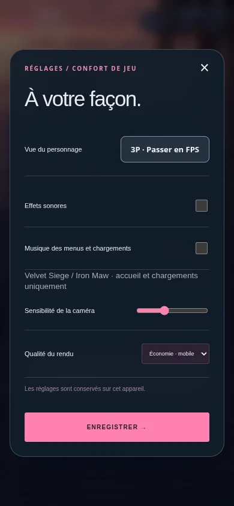
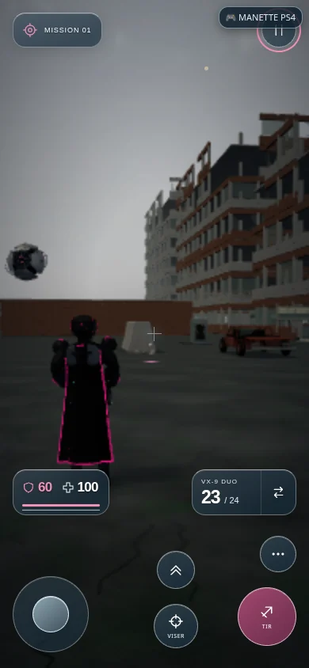

# Version 3.67.1 — bouton FPS / 3P dans les options

**Pause → Réglages → Vue du personnage** propose un bouton indiquant la vue actuelle et l’action suivante : **FPS · Passer en 3P** ou **3P · Passer en FPS**. Il est disponible dans M01, M02, l’Arène et le stand, ainsi que dans les réglages de l’accueil avant le chargement du jeu.

Le choix est conservé sur l’appareil et repris au prochain chargement. La touche V reste synchronisée avec le bouton. Le mode écran utilise cette préférence ; la vue immersive du casque garde son suivi de tête et ne remplace pas la préférence enregistrée.

M01 dispose maintenant d’une vraie vue à la troisième personne : modèle Shadow Unit natif, animations de déplacement et de saut, arme tenue par le personnage et tirs issus de son vrai canon. La caméra se rapproche devant les murs et les planchers surélevés. En FPS, le corps s’efface et l’arme de première personne reprend l’affichage. La touche V bascule entre ces deux vues dans la mission ; le mode de visite conserve son ancienne caméra libre.

## Vérification

**637 tests Node réussis**, aucun échec, test ignoré ou annulé. Les **20 contrôles ciblés** passent également. Quatre nouveaux cas couvrent la préférence partagée, les erreurs d’accès au stockage, le suivi du héros à différentes orientations/altitudes et l’évitement des murs et planchers par la caméra.

Le navigateur utilise les vrais boutons tactiles sur écran **390 × 844** : réglages de l’accueil, lancement en 3P, pause/options, passage en FPS et retour en 3P, puis rechargement. Les quatre modes sont vérifiés. Dans M01, un tir par Espace part exactement du canon de l’arme visible ; V bascule en FPS sans activer la caméra libre. Aucune erreur JavaScript ni ressource locale manquante. [Rapport](VIEW_OPTIONS_BROWSER_VERIFICATION.json).

Limites : Chromium/SwiftShader, résolution de rendu réduite, invulnérabilité préparée pendant les contrôles de menus ; aucun essai sur Safari/iPhone ou Quest physique, ni mesure de FPS matériel. La validation navigateur est locale ; le statut Vercel du commit confirme séparément la publication.

[Jouer](https://pink-war.vercel.app/?v=3.67.1) · [M01](https://pink-war.vercel.app/vesper-level1-v7.html?prologue=done&v=3.67.1) · [M02](https://pink-war.vercel.app/level2-test.html?v=3.67.1)

