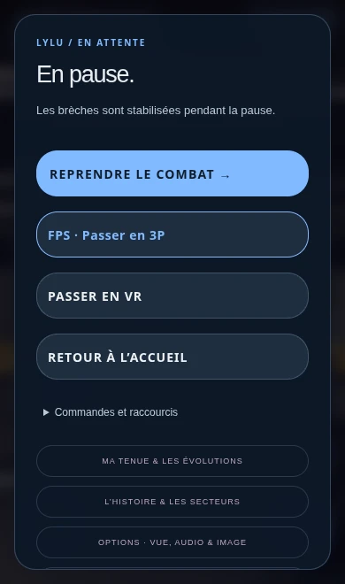

# Version 3.67.2 — FPS / 3P visible dès la pause

Le menu montré sur la capture masquait le choix de caméra derrière « Paramètres audio & image ». Le bouton **FPS · Passer en 3P** est maintenant placé directement sous **Reprendre le combat**, dans l’Arène, le stand, M01 et M02. En troisième personne, il affiche **3P · Passer en FPS**. Une bordure de la couleur du héros le distingue des autres actions.

Le changement conserve la pause, la partie et la préférence enregistrée. Le réglage dans les options reste disponible et synchronisé avec ce bouton et la touche V. L’ancien accès « Paramètres audio & image » s’appelle maintenant « Options · Vue, audio & image ». Le suivi immersif du casque conserve sa propre caméra.

La version des pages et des modules est renouvelée ; le module des boutons possède aussi une URL versionnée pour le rechargement des menus.

## Vérification

Quinze contrôles Node ciblés couvrent la préférence, la caméra et les parcours voisins de pause, HUD et XR. Vérification des vrais boutons tactiles dans les quatre modes : position visible dès l’ouverture sans défilement en 390 × 660, passage FPS / 3P dans les deux sens avec présence du vrai personnage, pause conservée, synchronisation avec les options et V, préférence après rechargement. Mise en page vérifiée aussi en 390 × 844, 844 × 390 et 1280 × 800. [Rapport navigateur](PAUSE_VIEW_BROWSER_VERIFICATION.json).

Essais navigateur locaux dans Chromium/SwiftShader avec framebuffer réduit et invulnérabilité préparée pendant les menus. Aucun appareil iPhone/Safari ou Quest physique ; confirmation de publication séparée par le statut Vercel du commit.

[Ouvrir la version corrigée](https://pink-war.vercel.app/?v=3.67.2)

